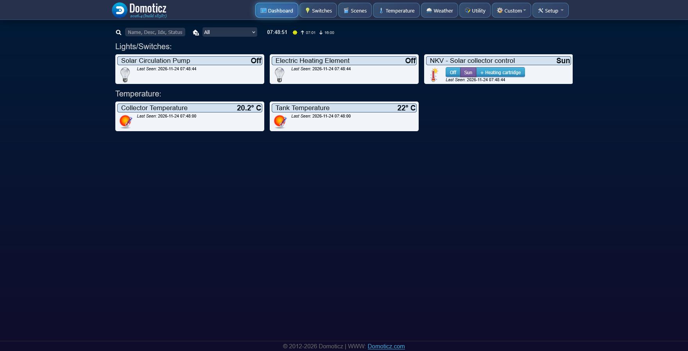
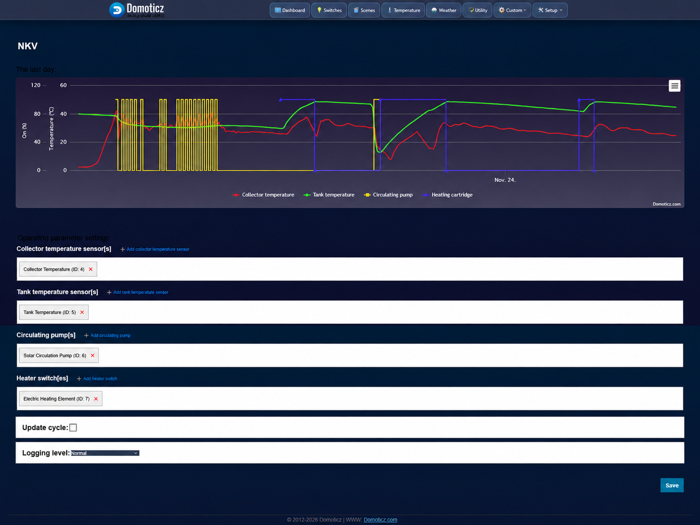
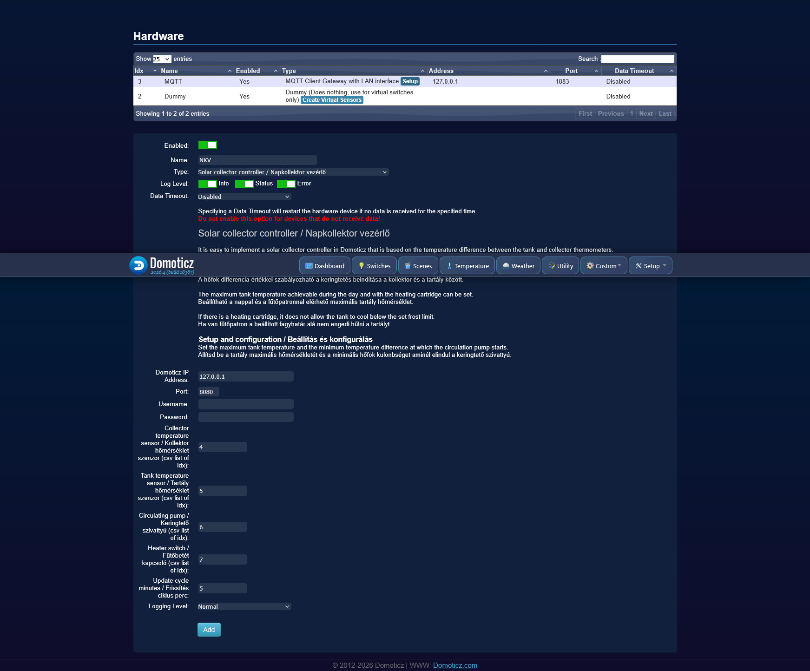

# Domoticz Solar Collector Controller

[English](#english) | [Magyar](#magyar)

## English

**Local, open-source solar domestic hot water (DHW) control for Domoticz.**

The Szélessáv Smart Home Solar Collector Controller is a Python plugin for automatically heating a domestic hot water storage tank using a solar thermal collector. It compares collector and tank temperatures, controls the circulation pump, and can optionally operate an electric immersion heater when solar energy is insufficient.

The controller runs locally in Domoticz without requiring a cloud service or an internet connection. It is primarily intended for evacuated-tube **drain-back** solar thermal installations; other hydraulic configurations require their own independent overheating, stagnation, and freeze-protection measures.

**Documentation:** [English overview](https://www.szelessavmuhely.hu/en/solar_collector_control) · [Features and operating modes](https://www.szelessavmuhely.hu/en/solar_collector_control/features_and_options) · [Installation guide](https://www.szelessavmuhely.hu/en/solar_collector_control/installation) · [Magyar dokumentáció](https://www.szelessavmuhely.hu/hu/napkollektor_vezerles)

## Screenshots

### Domoticz dashboard



### HTML control and configuration interface



### Hardware setup



## Features

- **Differential temperature control:** starts the circulation pump when the solar collector is sufficiently warmer than the DHW tank, subject to the configured tank temperature limit.
- **Solar energy priority:** uses available solar heat before enabling optional electric backup heating.
- **Three operating modes:** Off, Solar, and Solar + Electric Heater.
- **Adjustable setpoints:** maximum solar tank temperature, electric heater target temperature, pump temperature differential, frost-protection threshold, and electric heater hysteresis.
- **Scheduled electric heating:** change the heater target temperature with Domoticz timers to prepare hot water when it is needed.
- **Sensor monitoring:** ignores outdated temperature readings and switches affected outputs off when required measurements are unavailable.
- **Multiple devices per function:** comma-separated Domoticz IDX lists for sensors and switches; valid sensor readings are averaged.
- **Multilingual interface:** plugin translations and a separate HTML control panel with translations.
- **Fully local operation:** no proprietary gateway or external cloud is necessary when the sensors and switching hardware are locally available in Domoticz.

## Operating modes

| Mode | Behaviour |
| --- | --- |
| **Off** | Stops both the circulation pump and the electric heater. **Frost protection is also disabled.** |
| **Solar** | Runs the pump when useful solar heat is available. The optional electric heater is used only for tank frost protection. |
| **Solar + Electric Heater** | Prioritizes solar heat; uses the electric immersion heater to reach its scheduled target temperature when solar heat is insufficient. |

### Example settings

The plugin provides configurable setpoints with the following documented defaults:

| Parameter | Default |
| --- | ---: |
| Maximum tank temperature using solar heat | 75 °C |
| Electric heater target temperature | 50 °C |
| Collector/tank switching differential | 2 °C |
| Tank frost-protection threshold | 5 °C |
| Electric heater hysteresis | 2 °C |
| Control update interval | 5 minutes |

These are **software defaults**, not universally safe values. Set temperatures and protections to suit the installed tank, plumbing and applicable safety requirements.

## Requirements

- A working **Domoticz installation with Python plugin support**.
- At least one **solar collector temperature sensor** available in Domoticz.
- At least one **DHW tank temperature sensor** available in Domoticz.
- At least one **controllable circulation pump switch** available in Domoticz.
- Optional **electric immersion heater switch** available in Domoticz.
- The corresponding Domoticz device **IDX identifiers**.

Devices can use any suitable integration that exposes the necessary sensor values and switch controls to Domoticz. Where multiple IDX values are accepted, separate them with commas, for example `123,456,789`.

## Installation

The following paths correspond to the **Szélessáv SmartHome OpenWrt** layout. Adapt them for other Linux or Domoticz installations.

### 1. Download the repository

```sh
cd /tmp
git clone https://github.com/szelessavalapitvany/Domoticz-Solar-Collector.git
```

Alternatively, use **Code → Download ZIP** on GitHub and extract the archive.

### 2. Install the Python plugin and translations

```sh
mkdir -p /etc/domoticz/plugins/NKV_Napkollektor_Vezerlo
cp /tmp/Domoticz-Solar-Collector/plugin.py /etc/domoticz/plugins/NKV_Napkollektor_Vezerlo/
cp /tmp/Domoticz-Solar-Collector/nkv_translate_*.json /etc/domoticz/plugins/NKV_Napkollektor_Vezerlo/
```

### 3. Install the HTML interface

```sh
mkdir -p /usr/share/domoticz/www/templates
cp -r /tmp/Domoticz-Solar-Collector/viewer/* /usr/share/domoticz/www/templates/
```

Copy the **contents** of the `viewer` directory, including its HTML, JavaScript and translation files. The Python plugin and the web interface must both be installed for the complete configuration interface to work.

### 4. Restart Domoticz

On Szélessáv OpenWrt:

```sh
/etc/init.d/domoticz restart
```

On a systemd-based Linux system, if Domoticz is installed as a service:

```sh
sudo systemctl restart domoticz
```

### 5. Configure in Domoticz

Open **Setup → Hardware**, add a new hardware instance, and select **Solar collector controller / Napkollektor vezérlő**.

Set:

| Field | Description |
| --- | --- |
| Domoticz IP address | Usually `127.0.0.1` when running on the same host |
| Port | Domoticz HTTP port, commonly `8080` |
| Username / Password | Domoticz API credentials, if authentication is required |
| Collector temperature sensors | Comma-separated IDX values |
| Tank temperature sensors | Comma-separated IDX values |
| Circulation pump switches | Comma-separated IDX values |
| Electric heater switches | Optional comma-separated IDX values |
| Update interval | Control cycle in minutes (default: 5) |
| Logging level | Normal operation or more detailed troubleshooting |

Click **Add**. The plugin creates the required virtual devices, including operating-mode selection and temperature setpoints. Open the HTML configuration page from the Domoticz **Custom** menu.

**Szélessáv SmartHome OpenWrt:** Firmware versions that already include this controller do not require these manual file-copy steps; simply create and configure its hardware instance in Domoticz.

For detailed installation instructions, see the [English installation guide](https://www.szelessavmuhely.hu/en/solar_collector_control/installation) or the [Hungarian installation guide](https://www.szelessavmuhely.hu/hu/napkollektor_vezerles/telepites).

## Control logic and sensor safety

The pump operates when the collector is warmer than the storage tank by the configured differential, provided the solar maximum tank temperature has not been reached. In Solar + Electric Heater mode, solar collection takes priority over electric backup heating.

The plugin checks sensor freshness. Readings older than **10 minutes** are ignored. With multiple sensors, valid readings are averaged. When no valid collector temperature is available, the pump is stopped; when no valid tank temperature is available, both the pump and the electric heater are switched off.

In Solar mode, the optional heater can protect the **tank** against low temperature. This does **not** guarantee freeze protection of external piping or the collector.

## Updating

If the repository was cloned with Git:

```sh
cd /tmp/Domoticz-Solar-Collector
git pull
cp plugin.py /etc/domoticz/plugins/NKV_Napkollektor_Vezerlo/
cp nkv_translate_*.json /etc/domoticz/plugins/NKV_Napkollektor_Vezerlo/
cp -r viewer/* /usr/share/domoticz/www/templates/
/etc/init.d/domoticz restart
```

Keep the Python plugin, interface files and translations in sync when updating. Refresh your browser cache if the old interface remains visible.

## Safety notes

> **Important:** This software is not a replacement for mechanical, hydraulic or electrical safety devices. Provide suitable independent overtemperature protection, pressure relief, scald protection, electrical protections and freeze/stagnation management for your installation. In particular, non-drain-back systems need protection against stagnation and excess solar heat; the plugin has no dedicated heat-dump or pool-heating function. Observe the equipment manufacturer's limits and hot-water hygiene requirements, including Legionella prevention.

## Support and resources

- [Project website (English)](https://www.szelessavmuhely.hu/en/solar_collector_control)
- [Full feature descriptions (English)](https://www.szelessavmuhely.hu/en/solar_collector_control/features_and_options)
- [Installation instructions (English)](https://www.szelessavmuhely.hu/en/solar_collector_control/installation)
- [Magyar leírás](https://www.szelessavmuhely.hu/hu/napkollektor_vezerles)
- [Report a bug or request a feature](https://github.com/szelessavalapitvany/Domoticz-Solar-Collector/issues)

Developed as part of the **Szélessáv Smart Home** open-source project. Refer to the repository's license information for applicable licensing terms.

---

## Magyar

# Domoticz napkollektor-vezérlő

**Helyi, nyílt forráskódú használatimelegvíz- (HMV-) vezérlés Domoticz rendszerhez.**

A Szélessáv Okos Otthon napkollektor-vezérlője egy Python plugin, amely napkollektor segítségével automatikusan melegíti a használati melegvíz-tartályt. Összehasonlítja a kollektor és a tartály hőmérsékletét, vezérli a keringtető szivattyút, és szükség esetén az opcionális elektromos fűtőpatront is kapcsolja.

A vezérlő helyben, a Domoticz rendszerben működik, felhőszolgáltatás és internetkapcsolat nélkül. Elsősorban vákuumcsöves, **drain-back** rendszerű napkollektoros berendezésekhez készült. Más hidraulikai kialakítás esetén önálló túlmelegedés-, stagnáció- és fagyvédelem szükséges.

**Dokumentáció:** [Műszaki leírás](https://www.szelessavmuhely.hu/hu/napkollektor_vezerles) · [Telepítési útmutató](https://www.szelessavmuhely.hu/hu/napkollektor_vezerles/telepites)

## Képernyőképek

### Domoticz kezelőfelület


### HTML kezelő- és konfigurációs felület


### Hardverbeállítások


## Funkciók

- **Hőmérséklet-különbségen alapuló szabályozás:** a szivattyú akkor indul, ha a kollektor megfelelő mértékben melegebb a tartálynál, és a tartály még nem érte el a beállított maximális hőmérsékletet.
- **Napenergia elsőbbsége:** az opcionális elektromos rásegítés előtt a rendelkezésre álló napenergiát hasznosítja.
- **Három üzemmód:** Ki, Napkollektor, Napkollektor + fűtőpatron.
- **Állítható szabályozási értékek:** maximális tartályhőmérséklet, elektromos fűtés célhőmérséklete, kapcsolási hőmérséklet-különbség, fagyvédelmi határérték és fűtőpatron-hiszterézis.
- **Időzített elektromos fűtés:** a fűtőpatron célhőmérséklete Domoticz időzítőkkel módosítható.
- **Érzékelők ellenőrzése:** a vezérlő figyelmen kívül hagyja az elavult hőmérsékleti adatokat, és szükség esetén lekapcsolja az érintett kimeneteket.
- **Több eszköz támogatása funkciónként:** vesszővel elválasztott IDX azonosítók; az érvényes hőmérsékleti értékek átlagolása.
- **Többnyelvű kezelőfelület:** a plugin és a külön HTML kezelőfelület fordításai.
- **Teljesen helyi működés:** helyben elérhető Domoticz eszközök esetén nem szükséges gyártói átjáró vagy külső felhőszolgáltatás.

## Üzemmódok

| Üzemmód | Működés |
| --- | --- |
| **Ki** | A keringtető szivattyú és a fűtőpatron kikapcsol. **A fagyvédelem sem aktív.** |
| **Napkollektor** | A szivattyú hasznosítható napenergia esetén működik. Az opcionális fűtőpatron csak a tartály fagyvédelmét szolgálja. |
| **Napkollektor + fűtőpatron** | Elsődlegesen napenergiával fűt; elégtelen napenergia esetén elektromos rásegítéssel éri el a beállított célhőmérsékletet. |

### Alapértelmezett beállítások

| Paraméter | Alapérték |
| --- | ---: |
| Napenergiával elérhető maximális tartályhőmérséklet | 75 °C |
| Fűtőpatron célhőmérséklete | 50 °C |
| Kollektor és tartály kapcsolási hőmérséklet-különbsége | 2 °C |
| Tartály fagyvédelmi határértéke | 5 °C |
| Fűtőpatron hiszterézise | 2 °C |
| Vezérlési ciklus | 5 perc |

Ezek szoftveres alapértékek, nem minden rendszerben biztonságos beállítások. A konkrét berendezés műszaki adottságai és biztonsági követelményei alapján kell őket meghatározni.

## Követelmények

- Működő Domoticz rendszer Python plugin támogatással.
- Legalább egy napkollektor-hőmérő a Domoticz rendszerben.
- Legalább egy HMV-tartályhőmérő.
- Legalább egy vezérelhető keringtetőszivattyú-kapcsoló.
- Opcionális elektromos fűtőpatron-kapcsoló.
- Az érintett Domoticz eszközök IDX azonosítói.

Bármely megfelelő Domoticz-integráció használható, amely biztosítja a szükséges érzékelőadatokat és kapcsolási lehetőségeket. Több azonosító megadásakor vesszővel kell elválasztani azokat, például `123,456,789`.

## Telepítés

Az alábbi útvonalak a **Szélessáv Okos Otthon OpenWrt** rendszer könyvtárszerkezetének felelnek meg. Más Linux vagy Domoticz telepítésnél az útvonalakat a helyi környezethez kell igazítani.

### 1. A repository letöltése

```sh
cd /tmp
git clone https://github.com/szelessavalapitvany/Domoticz-Solar-Collector.git
```

Alternatív megoldásként a GitHub **Code → Download ZIP** menüpontjával tölthető le és csomagolható ki a repository.

### 2. A Python plugin és a nyelvi fájlok telepítése

```sh
mkdir -p /etc/domoticz/plugins/NKV_Napkollektor_Vezerlo
cp /tmp/Domoticz-Solar-Collector/plugin.py /etc/domoticz/plugins/NKV_Napkollektor_Vezerlo/
cp /tmp/Domoticz-Solar-Collector/nkv_translate_*.json /etc/domoticz/plugins/NKV_Napkollektor_Vezerlo/
```

### 3. A HTML kezelőfelület telepítése

```sh
mkdir -p /usr/share/domoticz/www/templates
cp -r /tmp/Domoticz-Solar-Collector/viewer/* /usr/share/domoticz/www/templates/
```

A `viewer` könyvtár tartalmát kell átmásolni, beleértve a HTML, JavaScript és nyelvi fájlokat. A teljes konfigurációs felülethez a Python plugin és a webes felület telepítése egyaránt szükséges.

### 4. A Domoticz újraindítása

Szélessáv OpenWrt rendszeren:

```sh
/etc/init.d/domoticz restart
```

Systemd alapú Linux rendszeren, ha a Domoticz szolgáltatásként van telepítve:

```sh
sudo systemctl restart domoticz
```

### 5. Beállítás a Domoticz rendszerben

A **Beállítások → Hardver** menüpontban adjunk hozzá új hardvert, és válasszuk a **Solar collector controller / Napkollektor vezérlő** típust.

| Mező | Leírás |
| --- | --- |
| Domoticz IP-cím | Azonos gépen általában `127.0.0.1` |
| Port | A Domoticz HTTP-portja, gyakran `8080` |
| Felhasználónév / jelszó | A Domoticz API hitelesítési adatai, ha szükségesek |
| Kollektor-hőmérők | Vesszővel elválasztott IDX azonosítók |
| Tartályhőmérők | Vesszővel elválasztott IDX azonosítók |
| Keringtető szivattyúk | Vesszővel elválasztott IDX azonosítók |
| Fűtőpatronok | Opcionális, vesszővel elválasztott IDX azonosítók |
| Frissítési idő | Vezérlési ciklus percben (alapérték: 5) |
| Naplózási szint | Normál működés vagy részletes hibakeresés |

A **Hozzáadás** gomb megnyomásakor a plugin létrehozza a szükséges virtuális eszközöket, köztük az üzemmódválasztót és a hőmérsékleti beállítóeszközöket. A HTML konfigurációs felület a Domoticz **Custom** menüjéből érhető el.

**Szélessáv Okos Otthon OpenWrt:** ha a firmware már tartalmazza a vezérlőt, a kézi fájlmásolás nem szükséges. Elegendő a hardver hozzáadása és konfigurálása.

Részletes útmutató: [Telepítés](https://www.szelessavmuhely.hu/hu/napkollektor_vezerles/telepites).

## Szabályozási logika és érzékelőhibák kezelése

A szivattyú akkor működik, ha a kollektor a beállított hőmérséklet-különbséggel melegebb a tartálynál, és a tartály még nem érte el a napenergiával megengedett maximális hőmérsékletet. Kombinált üzemmódban a napenergia elsőbbséget élvez az elektromos rásegítéssel szemben.

A plugin ellenőrzi az érzékelőadatok frissességét. A **10 percnél régebbi** értékeket figyelmen kívül hagyja. Több érzékelő esetén az érvényes értékeket átlagolja. Érvényes kollektor-hőmérséklet hiányában a szivattyú leáll; érvényes tartályhőmérséklet hiányában a szivattyú és a fűtőpatron is kikapcsol.

Napkollektor üzemmódban az opcionális fűtőpatron a **tartály** fagyvédelmét biztosíthatja. Ez nem garantálja a kültéri csővezetékek vagy a kollektor fagyvédelmét.

## Frissítés

Git segítségével letöltött repository esetén:

```sh
cd /tmp/Domoticz-Solar-Collector
git pull
cp plugin.py /etc/domoticz/plugins/NKV_Napkollektor_Vezerlo/
cp nkv_translate_*.json /etc/domoticz/plugins/NKV_Napkollektor_Vezerlo/
cp -r viewer/* /usr/share/domoticz/www/templates/
/etc/init.d/domoticz restart
```

A Python plugint, a kezelőfelületet és a fordításokat együtt kell frissíteni. Ha továbbra is a régi felület jelenik meg, frissítsük a böngésző gyorsítótárát.

## Biztonsági tudnivalók

> **Fontos:** a szoftver nem helyettesíti a mechanikai, hidraulikai és elektromos biztonsági berendezéseket. Gondoskodni kell a független túlmelegedés-védelemről, nyomáshatárolásról, forrázás elleni védelemről, elektromos védelemről, valamint a fagyás és stagnáció kezeléséről. A nem drain-back rendszerek külön stagnáció- és túlmelegedés-védelmet igényelnek; a plugin nem rendelkezik külön hőelvezetési vagy medencefűtési funkcióval. Figyelembe kell venni a gyártói határértékeket és a HMV higiéniai követelményeit, beleértve a Legionella elleni védekezést.

## Dokumentáció és támogatás

- [A projekt weboldala](https://www.szelessavmuhely.hu/hu/napkollektor_vezerles)
- [Telepítési útmutató](https://www.szelessavmuhely.hu/hu/napkollektor_vezerles/telepites)
- [Hibajelentés és fejlesztési javaslatok – GitHub Issues](https://github.com/szelessavalapitvany/Domoticz-Solar-Collector/issues)

A **Szélessáv Okos Otthon** nyílt forráskódú projekt keretében készült. A licencfeltételeket a repository licencinformációi tartalmazzák.
